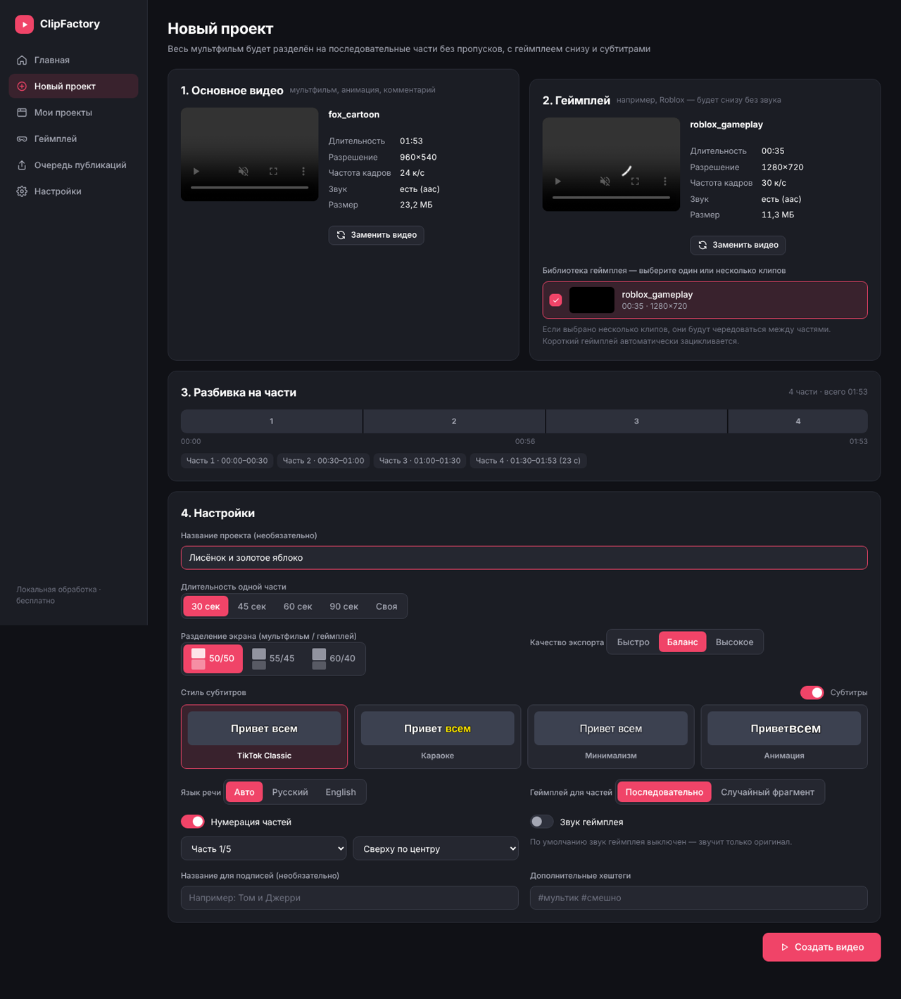
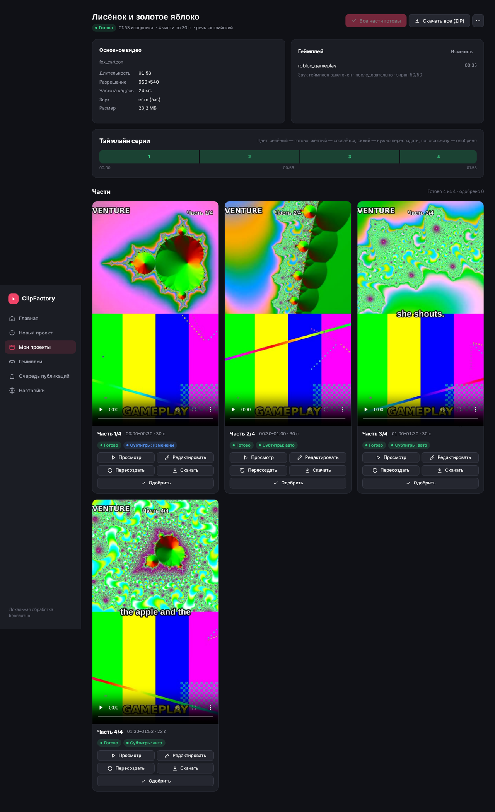
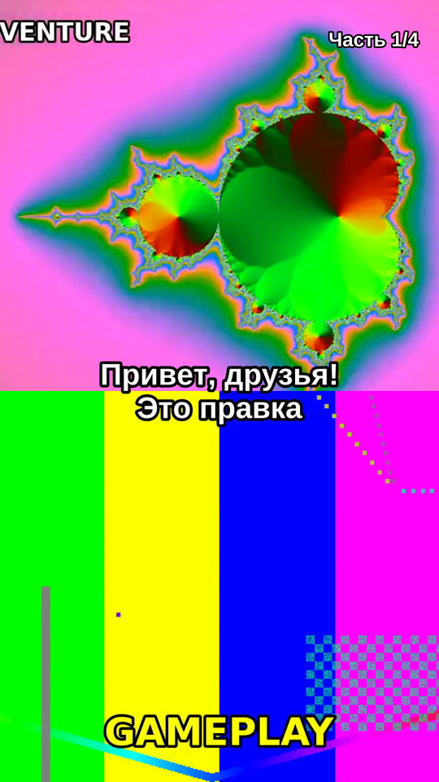

# ClipFactory

**ClipFactory** — локальная программа для Windows, которая автоматически превращает целый мультфильм (или другое видео, на которое у вас есть права) в серию вертикальных роликов для TikTok:

- мультфильм сверху, геймплей (например, Roblox) снизу — формат 1080×1920, 9:16;
- **весь** исходник делится на последовательные части (по умолчанию 60 секунд) — без пропусков, повторов и перестановок;
- субтитры создаются автоматически из речи (faster-whisper, локально) и вшиваются в видео;
- на каждой части — нумерация «Часть 1/5»;
- по умолчанию части **без звука и без озвучки — только субтитры** (звук оригинала можно включить переключателем «Звук оригинала»);
- предпросмотр, редактирование и пересоздание отдельных частей, одобрение перед публикацией;
- очередь публикаций: ручная загрузка в TikTok или официальный TikTok Content Posting API.

Вся обработка видео выполняется на вашем компьютере бесплатно: без платных API, облачных редакторов и хостинга. Интернет нужен только для скачивания видео по ссылке и для одноразовой загрузки модели распознавания речи.

| Новый проект | Готовая серия | Кадр результата |
|---|---|---|
|  |  |  |

---

## Содержание

1. [Требования](#требования)
2. [Установка](#установка)
3. [Запуск](#запуск)
4. [Как пользоваться](#как-пользоваться)
5. [Как устроена нарезка (гарантии)](#как-устроена-нарезка-гарантии)
6. [Субтитры](#субтитры)
7. [Геймплей](#геймплей)
8. [Публикация в TikTok](#публикация-в-tiktok)
9. [Настройки и производительность](#настройки-и-производительность)
10. [Где хранятся данные](#где-хранятся-данные)
11. [Решение проблем](#решение-проблем)
12. [Для разработчиков: структура и тесты](#для-разработчиков-структура-и-тесты)
13. [Правовые ограничения](#правовые-ограничения)

---

## Требования

- Windows 10 или 11 (64-бит);
- **Python 3.11 или новее** — https://www.python.org/downloads/windows/ (при установке отметьте «Add python.exe to PATH»);
- **FFmpeg** — `setup.bat` предложит скачать его автоматически;
- 8 ГБ ОЗУ и больше рекомендуется; свободное место на диске — примерно в 2–3 раза больше размера исходных видео;
- видеокарта не обязательна. Если есть NVIDIA / Intel / AMD с аппаратным кодированием, ClipFactory использует её автоматически.

Docker не нужен.

## Установка

1. Скачайте или клонируйте проект в любую папку, например `C:\ClipFactory`.
2. Дважды щёлкните **`setup.bat`**. Скрипт:
   - проверит Python;
   - создаст виртуальное окружение `.venv`;
   - установит библиотеки из `requirements.txt`;
   - проверит FFmpeg и, если его нет, предложит скачать бесплатную сборку в `tools\ffmpeg` (системные настройки не меняются);
   - подготовит папки и базу данных.
3. Если что-то пошло не так, скрипт объяснит причину по-русски. Устраните её и запустите `setup.bat` ещё раз — повторный запуск безопасен.

## Запуск

Дважды щёлкните **`start.bat`**. Откроется окно консоли, и через пару секунд в браузере откроется ClipFactory по адресу `http://127.0.0.1:8765/`.

- Не закрывайте окно консоли, пока работаете с программой.
- Программа доступна только с этого компьютера (сервер слушает `127.0.0.1`).
- Если порт 8765 занят, ClipFactory выберет следующий свободный и откроет браузер сам.
- Если программа закрылась во время обработки, при следующем запуске задача продолжится: готовые части не пересоздаются.

## Как пользоваться

### 1. Новый проект

Раздел **«Новый проект»**:

1. **Основное видео** — вставьте ссылку и нажмите «Загрузить» либо выберите файл с компьютера. Появятся превью, длительность, разрешение, частота кадров и наличие звука.
2. **Геймплей** — так же добавьте ссылку или файл, либо отметьте один или несколько клипов из библиотеки.
3. **Разбивка на части** — сразу показывает, на сколько частей будет разделено видео и где проходят границы.
4. **Настройки** — длительность части (30/45/60/90 секунд или своя), разделение экрана (50/50, 55/45, 60/40), стиль субтитров, язык речи, нумерация, звук геймплея, качество.
5. Нажмите **«Создать видео»**. Проект откроется, и обработка начнётся автоматически.

### 2. Обработка

На странице проекта видны этапы: «Загрузка видео» → «Анализ исходника» → «Распознавание речи» → «Подготовка геймплея» → «Добавление субтитров» → «Создание части 2 из 6» → «Проверка результата» → «Готово». Там же — процент, оставшееся время и кнопка **«Отмена»**. Если задача завершилась ошибкой, появится понятное сообщение и кнопка **«Повторить»**.

Кнопка **«Создать все части»** запускает весь конвейер одним нажатием и досоздаёт части, которые ещё не готовы.

### 3. Проверка и редактирование

Каждая часть — отдельная карточка с вертикальным плеером, длительностью, статусом рендера и субтитров и кнопками:

- **«Просмотр»** — большой плеер;
- **«Редактировать»** — редактор части:
  - *Субтитры*: текст и время каждой фразы, добавление и удаление фраз, сдвиг всех фраз;
  - *Стиль*: пресет, шрифт, размер, цвета, обводка, цвет подсветки, вертикальное положение, анимация, заглавные буквы;
  - *Кадрирование*: какая часть кадра мультфильма и геймплея останется видна; разделение экрана;
  - *Геймплей*: другой клип из библиотеки, начальная секунда или случайный фрагмент;
  - *Нумерация*: текст, положение, размер, отступ;
- **«Пересоздать»** — заново отрисовывает только эту часть;
- **«Скачать»** — MP4;
- **«Одобрить»** — отметка, что вы проверили часть.

Части **никогда не одобряются автоматически**. После пересоздания одобрение снимается — новую версию нужно проверить снова.

В меню «⋯» проекта: «Одобрить все готовые части», «Пересоздать все части», «Распознать речь заново», «Обновить подписи и хештеги», «Настройки проекта», «Удалить проект». Кнопка «Скачать все (ZIP)» собирает архив со всеми частями, файлами субтитров и подписями.

### 4. Публикация

Раздел **«Очередь публикаций»** — см. [Публикация в TikTok](#публикация-в-tiktok).

## Как устроена нарезка (гарантии)

Самое важное требование — сохранить мультфильм целиком. Поэтому:

- Границы частей считаются **в кадрах исходника**: часть *k* содержит кадры `[начало, конец)`, а следующая начинается ровно с кадра `конец`. Пропусков и наложений нет — это проверяется перед рендером.
- Порядок сцен не меняется, ничего не вырезается и не сокращается, тишина не удаляется.
- Пример: 5:00 при частях по 60 секунд → 5 частей по 60 с; 5:23 → 5 частей по 60 с и последняя 23 с.
- Если остаток меньше 3 секунд (настраивается), он присоединяется к предыдущей части, а не теряется. Например, 2:01 → 60 с + 61 с.
- Если включён «Звук оригинала», звук режется по тем же временным меткам, что и кадры, поэтому синхронность сохраняется на стыках частей. Смещения начала дорожек и задержка AAC-кодера учитываются.
- Видео с **переменной частотой кадров** (часто — записи экрана и телефоны) сначала один раз выравниваются до постоянной частоты, затем нарезаются.
- Каждая готовая часть проверяется через ffprobe: H.264 + AAC, 1080×1920, точное число кадров и длительность звука. При несоответствии часть помечается ошибкой и не считается готовой.

Автотесты проверяют это на синтетическом видео, у которого яркость каждого кадра кодирует его номер: в каждой части сравнивается **каждый кадр**, а звуковые метки проверяются на смещение меньше 10 мс.

## Субтитры

- Субтитры создаются из речи оригинала, даже когда звук в готовых частях выключен (режим по умолчанию: без звука, только субтитры). В файле всё равно есть тихая аудиодорожка — так TikTok корректно принимает видео.
- Распознавание выполняет **faster-whisper** локально: русский, английский или автоопределение языка, временные метки на уровне слов, автоматическая пунктуация.
- Видео распознаётся **один раз** целиком, затем фразы распределяются по частям. Результат кэшируется: повторный рендер, смена стиля или замена геймплея не запускают распознавание заново.
- Фразы — по 2–5 слов, не более 2 строк. Субтитр никогда не появляется раньше, чем прозвучало слово. Слово на стыке частей относится к той части, где звучит его бо́льшая половина.
- Пресеты: **TikTok Classic** (по умолчанию: белый жирный текст с толстой чёрной обводкой), **Караоке** (текущее слово подсвечивается жёлтым), **Минимализм**, **Анимация** (слова появляются по очереди с лёгким «поп»-эффектом).
- По умолчанию субтитры стоят на границе мультфильма и геймплея. Номер части автоматически переносится, если перекрывается с субтитрами.
- Субтитры вшиваются в MP4 через libass. Для каждой части также сохраняются редактируемые файлы `.ass` и `.srt`.

**Модель Whisper.** При первом распознавании выбранная модель скачивается один раз (small ≈ 480 МБ) в `storage\models`, дальше всё работает без интернета. Модель выбирается в «Настройках»: tiny/base — быстрее, medium/large-v3 — точнее, но медленнее на процессоре. На видеокарте NVIDIA с CUDA распознавание идёт заметно быстрее; если CUDA недоступна, используется процессор.

**Свои шрифты.** Положите файлы `.ttf`/`.otf` в папку `storage\fonts` и укажите название шрифта в стиле субтитров. Без этого доступны шрифты Windows (Arial, Impact, Segoe UI и т. д.).

## Геймплей

- Звук геймплея по умолчанию выключен. Его можно включить и задать громкость.
- Если геймплей короче части, он зацикливается. Двухминутного клипа хватит на десятиминутный мультфильм.
- Чёрные кадры в начале и конце клипа определяются автоматически и не попадают в видео.
- Режимы: «Последовательно» — части идут по клипу подряд, чтобы повторов было как можно меньше; «Случайный фрагмент» — для каждой части свой случайный участок. При нескольких клипах они чередуются.
- Геймплей отдельной части меняется в редакторе. Распознавание и обработка мультфильма при этом не повторяются.
- Видео масштабируется без искажений и обрезается по краям (центрированное кадрирование), чтобы не было чёрных полос.

## Публикация в TikTok

ClipFactory использует **только официальные способы**: не обходит CAPTCHA и защиту от ботов, не использует cookies и не автоматизирует браузер.

### Режим A — ручная публикация (работает всегда)

В «Очереди публикаций» для каждой части доступны:

- «Скачать MP4»;
- «Копировать подпись» и «Копировать хештеги» (подписи генерируются автоматически и редактируются);
- «Открыть TikTok» — официальная страница загрузки;
- «Отметить опубликованным» (можно сохранить ссылку на пост);
- дата и время публикации. В назначенное время ClipFactory напомнит о публикации: счётчик в меню и уведомление.

### Режим B — официальный TikTok Content Posting API

Для этого нужно **собственное приложение разработчика TikTok**:

1. Зарегистрируйтесь на https://developers.tiktok.com/ и создайте приложение.
2. Подключите продукты **Login Kit** и **Content Posting API** и запросите права `user.info.basic`, `video.upload`, `video.publish`.
3. Добавьте Redirect URI, который показан в ClipFactory («Настройки» → «TikTok»). По умолчанию: `http://127.0.0.1:8765/api/publish/tiktok/callback`. Проверьте в кабинете TikTok, разрешён ли для вашего типа приложения локальный адрес.
4. Введите в «Настройках» Client Key и Client Secret, нажмите «Сохранить ключи», затем «Подключить аккаунт TikTok» и разрешите доступ.

После этого в очереди появится кнопка «Опубликовать через API» с двумя режимами:

- **Опубликовать** — прямая публикация. Уровни приватности берутся из ответа TikTok для вашего аккаунта.
- **Во «Входящие»** — видео загружается в приложение TikTok, а пост вы завершаете сами.

Важные ограничения TikTok:

- **Пока приложение не прошло аудит TikTok, прямые публикации видны только вам** («Только я», SELF_ONLY). Для публичных постов используйте ручной режим или «Входящие», либо пройдите аудит.
- TikTok ограничивает число запросов и публикаций в сутки. ClipFactory соблюдает лимиты и показывает ошибки TikTok по-русски.
- Публикация считается успешной **только после подтверждения** через официальный статус. Пока TikTok обрабатывает видео, статус — «Публикуется».
- Публикуются только **одобренные** части.
- Отложенная публикация через API выполняется самим ClipFactory, поэтому в назначенное время программа должна быть запущена. Если она была закрыта или часть не одобрена, вы увидите напоминание, а публикации не будет.

Токены хранятся зашифрованными (Windows DPAPI, привязка к вашей учётной записи Windows) в `storage\secrets` и не пишутся в журналы.

## Настройки и производительность

- **Качество экспорта**: «Быстро», «Баланс» (по умолчанию), «Высокое». Выход — H.264 + AAC, MP4 с faststart, совместим с TikTok.
- **Кодировщик**: автоматически — NVENC / Quick Sync / AMF, если реально работает, иначе процессор (libx264). При сбое аппаратного кодировщика часть пересоздаётся на процессоре.
- **Одновременно создаваемых частей**: 1–4, для обычного ПК — 1–2.
- Каждая часть кодируется **один раз**: нарезка, композиция, субтитры и нумерация делаются в одном проходе FFmpeg. Видео не загружается в память целиком.
- Скачанные видео и результаты распознавания кэшируются и используются повторно.
- Лимиты размера скачивания и загрузки настраиваются.

## Где хранятся данные

Всё хранится в папке `storage` (подробнее — `storage\README.md`): исходники, библиотека геймплея, готовые части (`storage\projects\<id>\episodes\Part_01.mp4`), субтитры, кэш, модели и журнал `storage\logs\clipfactory.log`. Для резервной копии скопируйте папку `storage`. Другую папку данных можно указать в `.env` (`CLIPFACTORY_STORAGE`).

## Решение проблем

| Проблема | Решение |
|---|---|
| «FFmpeg не найден» | Запустите `setup.bat` и согласитесь скачать FFmpeg, либо положите `ffmpeg.exe` и `ffprobe.exe` в `tools\ffmpeg\bin`. |
| «Сборка FFmpeg без libass» | Используйте сборку gyan.dev «release essentials» или «full». |
| «Не удалось загрузить модель распознавания речи» | При первом распознавании нужен интернет. Проверьте подключение или выберите модель поменьше (base/tiny). |
| «Эта ссылка не поддерживается» / «Видео недоступно» | Скачайте видео, на которое у вас есть права, и загрузите его файлом. |
| «Видео требует входа в аккаунт…» | ClipFactory не обходит ограничения доступа — используйте свой файл. |
| Распознавание очень медленное | Выберите модель «base» или «tiny» либо включите CUDA (NVIDIA). |
| Рендер медленный | Качество «Быстро», 1 параллельная часть, проверьте аппаратный кодировщик в «Настройки» → «Система». |
| Программа закрылась во время обработки | Запустите `start.bat` — задача продолжится автоматически. |

Технические подробности ошибок — в `storage\logs\clipfactory.log` и в раскрывающемся блоке «Технические подробности» у сообщения об ошибке.

## Для разработчиков: структура и тесты

```
backend/
  main.py              — FastAPI-приложение, запуск, защита localhost
  config.py            — пути и параметры
  api/                 — HTTP-маршруты (media, projects, episodes, jobs, publish, system)
  services/
    downloader.py      — yt-dlp, проверка ссылок, безопасные имена файлов
    video_analyzer.py  — ffprobe: длительность, потоки, VFR, чёрные кадры
    video_splitter.py  — кадрово-точный план частей
    gameplay_manager.py— выбор и зацикливание геймплея
    subtitle_generator.py — faster-whisper, фразы, перенос по частям, ASS/SRT, пресеты
    video_composer.py  — граф фильтров FFmpeg (split-screen + субтитры)
    renderer.py        — рендер части, проверка ffprobe, миниатюры
    encoders.py        — NVENC/QSV/AMF/libx264
    publisher.py       — TikTok OAuth + Content Posting API
    captions.py        — подписи и хештеги
    secure_store.py    — хранение токенов (DPAPI)
  jobs/                — постоянная очередь задач, конвейер, планировщик публикаций
  database/db.py       — SQLite
  models/schemas.py    — Pydantic-модели
frontend/              — интерфейс (HTML/CSS/JS без сборки)
tests/                 — автотесты
```

Запуск тестов (нужны FFmpeg и `pip install -r requirements-dev.txt`):

```
.venv\Scripts\python -m pytest -q
```

Тесты проверяют: определение длительности; расчёт границ частей; полное сохранение таймлайна (каждый кадр); отсутствие пропусков и наложений; короткую последнюю часть; зацикливание геймплея; перенос субтитров и фразы на стыках частей; синхронность звука и видео; разрешение, кодеки и длительность через ffprobe; пакетный рендер; сохранение проекта; восстановление после прерывания; отмену и повтор задач; статусы публикации (TikTok API через имитацию HTTP); безопасность ввода. Отдельные интеграционные тесты: синтетический источник 5:00 даёт ровно 5 частей по 60 с, 5:23 — 6 частей с последней 23 с.

В автотестах распознавание речи заменяется детерминированной заглушкой, потому что настоящая модель Whisper скачивается из интернета. Всё остальное — реальный FFmpeg-рендер.

## Правовые ограничения

Используйте только видео, которые принадлежат вам или которые вы имеете право использовать (лицензия, разрешение правообладателя или иное законное основание). ClipFactory не обходит DRM, авторизацию и ограничения платформ и публикует в TikTok только через официальные механизмы. Ответственность за соблюдение авторских прав и правил платформ несёт пользователь.
